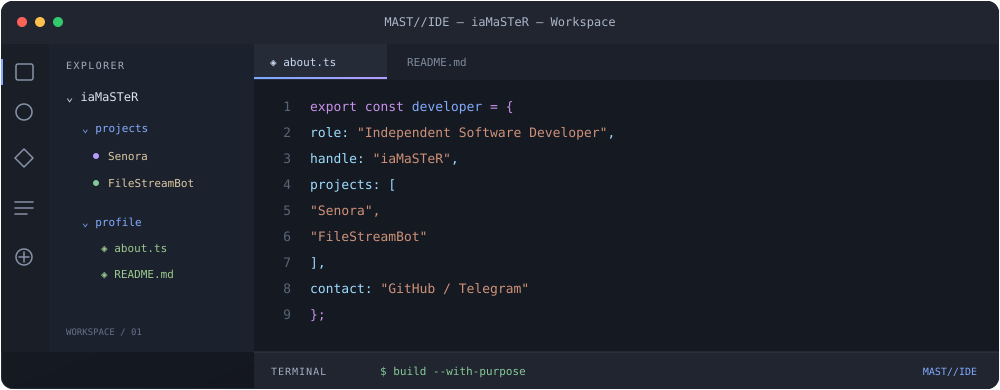

  

 

### Independent Software Developer

I build software, explore ideas, and turn them into working projects.

[GitHub Profile](https://github.com/iaMaSTeR-Dev)

---

## `01` / Selected Projects

A selection of projects I'm working on.

<table>
  <tr>
    <td width="50%" valign="top">
      <h3>◈ Senora</h3>
      
A privacy-focused messaging project.

      <a href="https://github.com/iaMaSTeR-Dev/Senora">View Repository →</a>
    </td>
    <td width="50%" valign="top">
      <h3>◈ FileStreamBot</h3>
      
A Telegram bot project for generating file streaming links.

      <a href="https://github.com/iaMaSTeR-Dev/FileStreamBot">View Repository →</a>
    </td>
  </tr>
</table>

---

## `02` / About

I'm an independent developer interested in building practical software and working through engineering challenges.

I value clear architecture, thoughtful implementation, and continuous improvement.

---

## `03` / Connect

[GitHub](https://github.com/iaMaSTeR-Dev)

MAST//IDE · Built with intention.

